# Employee Performance Predictor using Data Analytics

An educational data-analytics project that demonstrates how a team can use **synthetic employee-like records** to explore patterns and build a transparent performance-prediction workflow.

> **Important responsible-use notice**  
> The data for this project is synthetic. It does not describe real people, a real employer, or validated workplace outcomes. This project is for learning, portfolio demonstration, and interview discussion only. It is **not for employment decisions** and must not be used to make, recommend, automate, or justify actions such as hiring, promotion, compensation, discipline, scheduling, or termination.

## Project at a glance

| Item | Description |
| --- | --- |
| Audience | Students, beginner data analysts, and interview reviewers |
| Core question | Can structured, synthetic workplace indicators be used to estimate a clearly defined performance outcome? |
| Learning focus | Data quality, exploratory analysis, supervised learning, evaluation, explainability, and responsible use |
| Recommended student stack | Python, pandas, scikit-learn, matplotlib/seaborn, and Jupyter |
| Current repository state | Runnable synthetic-data pipeline with saved model, metrics, predictions, and plots |
| Evidence policy | Report only metrics, charts, and observations that were actually generated and saved |

## Why this project is useful

Performance analytics is a good teaching example because it combines several practical skills:

- translating a vague business question into a measurable target;
- checking whether a dataset is complete, consistent, and understandable;
- separating exploration from model evaluation;
- comparing a simple baseline with one or more candidate models;
- explaining what a model learned without treating correlation as causation; and
- communicating limitations before presenting a result.

The project is intentionally framed as a **simulation**. A fictional company can provide realistic context without exposing employee information or implying that the model has been validated in an actual workplace.

## Beginner explanation

Imagine a teacher asking whether attendance, training completion, project participation, and feedback scores are related to a course outcome. An employee-performance project asks a similar question with a carefully defined target, such as a synthetic performance band.

The model does not “understand” a person and does not discover someone’s potential. It finds statistical patterns in the examples it receives. A prediction is therefore an estimate with uncertainty, not a fact about a person. The quality of the estimate depends on the definition of the target, the quality of the data, the fairness of the measurement process, and whether the examples represent the situation in which the model would be used.

## Technical explanation

This is a proposed supervised-learning workflow:

1. Define a target variable and a data dictionary before modeling.
2. Create or load a synthetic tabular dataset.
3. Validate types, missing values, duplicates, ranges, and category labels.
4. Explore distributions and relationships without using the test set to tune decisions.
5. Split data into training and test partitions using a documented rule.
6. Fit preprocessing steps on the training data only.
7. Train an interpretable baseline and candidate model(s).
8. Evaluate on held-out data with metrics appropriate to the target type.
9. Inspect errors, subgroup summaries, and feature explanations.
10. Save reproducible artifacts and document limitations.

The exact target type—classification, regression, or an ordinal performance band—must be chosen and recorded before implementation. No metric is claimed in this repository until it is produced from a defined dataset and a repeatable run.

## Business value and boundaries

### Possible educational value

In a fictional business setting, the workflow can help a student practice how analytics teams might:

- identify data-quality issues before reporting;
- summarize training or workload patterns;
- design a repeatable evaluation process;
- create a transparent “what-if” analysis for planning conversations; and
- communicate uncertainty and limitations to non-technical stakeholders.

### What it cannot prove

- A correlation is not evidence that a feature causes performance.
- A model score is not proof that a person will perform a certain way.
- Historical or synthetic labels can encode the assumptions used to create them.
- A high average metric can hide poor performance for a subgroup or rare class.
- Removing a sensitive field does not remove proxy or measurement bias.
- A model trained on synthetic records is not validated for any real employer.

Read the full responsible-use checklist in [`PROJECT_GUIDE.md`](PROJECT_GUIDE.md) before presenting results.

## Recommended technology choices

Three reasonable implementations are described in the guide:

1. **Selected student option — Python notebook/script workflow:** pandas + scikit-learn + matplotlib/seaborn + Jupyter. Best for learning fundamentals with low infrastructure overhead.
2. **Portfolio demo option — Python workflow plus Streamlit:** adds a small interactive interface after the analysis is reproducible.
3. **Business-analytics option — SQL/Power BI with Python support:** emphasizes data modeling, dashboards, and stakeholder communication.

The first option is the recommended starting point. The selected stack is a design decision for this guide, not evidence that an implementation or dependency file already exists.

## Target architecture and data flow

```mermaid
flowchart LR
    A[Project question and target definition] --> B[Synthetic data generator or input file]
    B --> C[Data validation and data dictionary]
    C --> D[Exploratory analysis]
    D --> E[Train/test split]
    E --> F[Preprocessing pipeline]
    F --> G[Baseline and candidate models]
    G --> H[Held-out evaluation and error analysis]
    H --> I[Explainability and responsible-use review]
    I --> J[Saved tables, charts, and written evidence]
    J --> K[Optional notebook, dashboard, or presentation]
```



The runnable code follows this flow: `main.py` calls the CLI, the CLI runs the pipeline, and the pipeline writes the documented artifacts.

## Repository structure

```text
.
├── README.md
├── PROJECT_GUIDE.md
├── LICENSE
├── .gitignore
├── requirements.txt                 # Runtime and test dependencies
├── data/
│   └── synthetic_hr_data.csv       # Generated synthetic source data
├── src/                             # Data generation, preprocessing, modeling, evaluation, and plots
├── tests/                           # Reproducibility and smoke checks
├── outputs/                         # Quality report, EDA summary, metrics, and predictions
├── images/                          # Generated charts
├── models/                          # Serialized model pipeline generated by the run
└── docs/
    └── evidence/                    # Optional reviewed screenshots
```

The repository includes the implementation and artifact directories. Generated model and tabular outputs are ignored by Git by default; keep reviewed screenshots or small evidence files under `docs/evidence/` when you want to publish them.

## Setup and run guide

The complete Windows and macOS/Linux instructions are in [`PROJECT_GUIDE.md`](PROJECT_GUIDE.md). The short version is:

### Windows PowerShell

```powershell
py -3 -m venv .venv
& .\.venv\Scripts\Activate.ps1
python -m pip install --upgrade pip
python -m pip install -r requirements.txt
```

### macOS/Linux

```bash
python3 -m venv .venv
source .venv/bin/activate
python -m pip install --upgrade pip
python -m pip install -r requirements.txt
```

The implementation is runnable from the repository root with `python main.py`. The `--samples`, `--seed`, `--test-size`, and `--project-root` flags make repeatable experiments easy to document.

## Expected result artifacts

Use stable names so a reviewer can find evidence quickly. The default run creates the following files:

| Recommended path | What it should contain |
| --- | --- |
| `data/synthetic_hr_data.csv` | 1,000 reproducible synthetic employee records |
| `outputs/data_quality_report.csv` | Per-column type, missingness, uniqueness, range, and duplicate checks |
| `outputs/eda_summary.csv` | Target distribution and department-level summary metrics |
| `models/employee_performance_model.joblib` | Fitted preprocessing + logistic regression pipeline |
| `outputs/metrics.json` | Accuracy, weighted precision/recall/F1, ROC-AUC, confusion matrix, and run metadata |
| `outputs/predictions.csv` | Held-out employee IDs, predicted label, probability, and actual label |
| `images/class_distribution.png` | Synthetic target-class counts |
| `images/confusion_matrix.png` | Held-out classification errors |
| `images/feature_coefficients.png` | Most influential logistic-regression associations |
| `images/department_performance.png` | Synthetic high-performance rate by department |

### Verified smoke-run results

The latest verified default run in this workspace used 1,000 rows with seed 42 and produced the metrics below. Re-run `python main.py` after cloning and replace them with your own run if you change the seed, sample count, or dependencies:

| Model | Evaluation split | Primary metric | Value |
| --- | --- | --- | --- |
| Logistic Regression pipeline | Held-out test set | Accuracy | `0.630` (1,000-row run) |
| Logistic Regression pipeline | Held-out test set | Weighted F1 | `0.641` (1,000-row run) |
| Logistic Regression pipeline | Held-out test set | ROC-AUC | `0.706` (1,000-row run) |

These numbers are illustrative run evidence, not a claim about real employees or business impact. Do not report them as production performance.

## Virtual company simulation

The guide uses a fictional company, **Northstar Services**, only as a narrative wrapper. It can be replaced with another invented organization. A simulation should define departments, role families, a time period, a synthetic target-generation rule, and a data dictionary. It should never be presented as an analysis of an actual employer or employee population.

## Evidence-first submission checklist

Before sharing the repository, confirm that you can point to:

- the target definition and data dictionary;
- a data-quality report;
- at least one exploratory chart with a plain-language caption;
- the train/test split and preprocessing rule;
- a baseline comparison and selected metric(s);
- an error or subgroup analysis appropriate to the target;
- saved output filenames and the command used to generate them;
- the synthetic-data and non-employment-use notice; and
- a clean GitHub history with descriptive commits.

The exact screenshot names and acceptance criteria are listed in [`PROJECT_GUIDE.md`](PROJECT_GUIDE.md).

## Responsible-use statement for presentations

Use language such as:

> “This is a synthetic, educational demonstration of a supervised-learning workflow. The outputs show how to validate data, compare models, and discuss uncertainty. They are not evidence about real employees and are not suitable for employment decisions.”

Avoid language such as “the model identifies high performers” or “the model proves who should be promoted.”

## Future improvements

Potential next steps include stronger data contracts, reproducible configuration, cross-validation, calibration, subgroup error analysis, model cards, drift checks, a small Streamlit interface, automated tests for data validation, and a CI workflow that builds the documentation and checks required artifacts.

## Documentation

- [`PROJECT_GUIDE.md`](PROJECT_GUIDE.md) — detailed beginner-to-technical build guide, runbook, evidence plan, GitHub workflow, interview preparation, and troubleshooting.

## License

The repository includes an MIT license template in [`LICENSE`](LICENSE). Replace the placeholder copyright holder before publishing under that license, and verify that the dependency licenses are compatible.

## Author
*Sanchita Giri* — 3rd Year CSE Student, Jawaharlal Darda Institute of Engineering & Technology, Yavatmal  
[LinkedIn](linkedin.com/in/sanchita-vijay-giri-28563b3b0) 